# OpenLog 功能截图

所有截图来自**演示模式**（`OPENLOG_DEMO=1`）—— 内置的确定性假数据，不连接任何真实服务器/集群。
想自己看同样的界面：

```bash
OPENLOG_DEMO=1 OPENLOG_DATA_DIR=/tmp/openlog-demo/data npm run dev
# 打开 http://127.0.0.1:5173
```

> 截图用 1680px 宽、整页高度抓取，所以每张都包含该页面的全部卡片。

---

## 仪表盘 · `/dashboard`

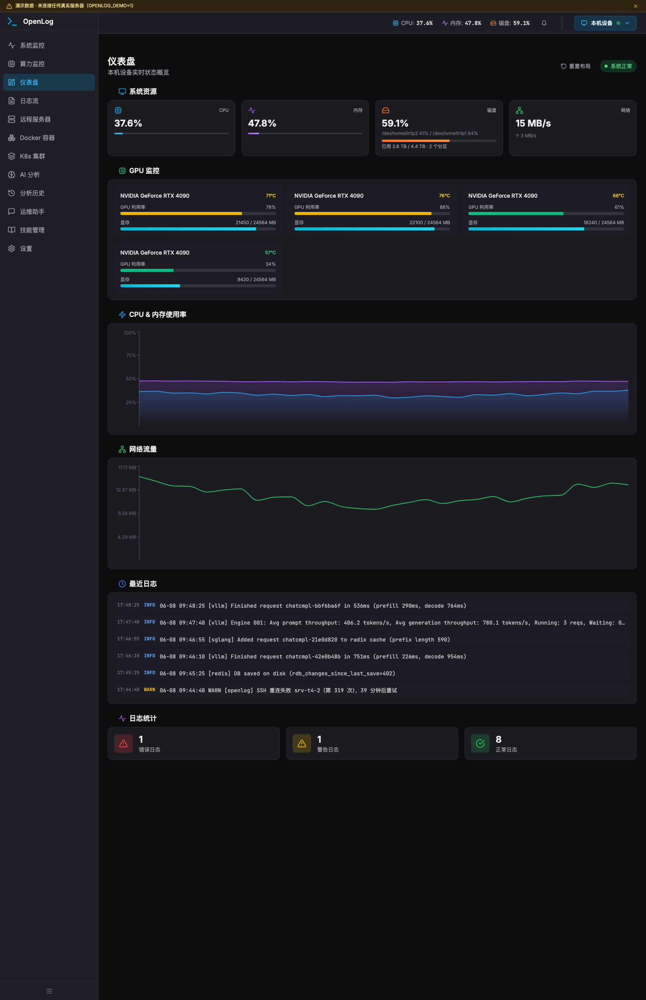

全局总览：节点/Pod/工作负载/Warning 统计、容器异常、算力水位、最近分析记录。
演示模式下顶部有通栏琥珀色提示「演示数据 · 未连接任何真实服务器」。

## 系统监控 · `/monitor`

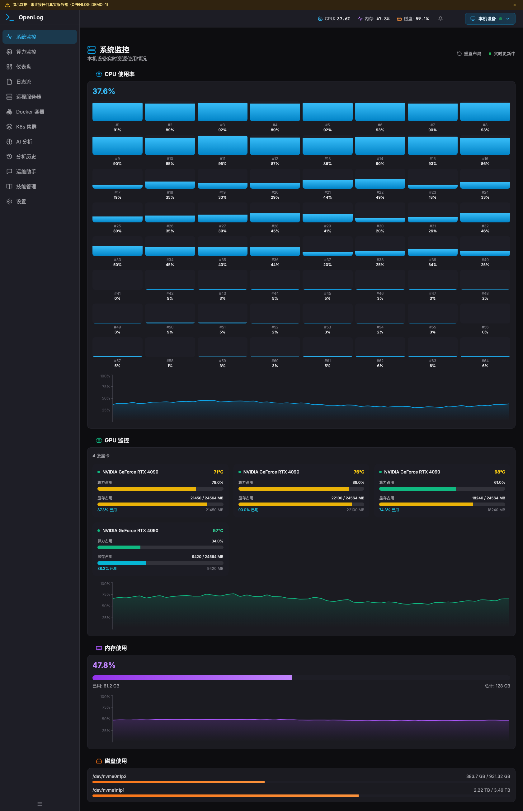

CPU（64 核逐核曲线）、内存、磁盘、网络、进程 Top、容量告警（内存/磁盘阈值）。
本机与远程服务器同一套图表。

## 算力监控 · `/gpu`

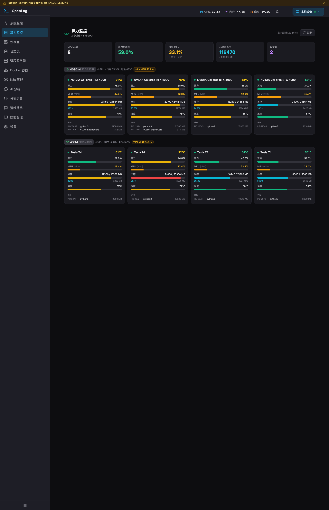

GPU 清单（型号/显存/利用率/温度/功耗）、每张卡上的进程、**MFU**（引擎 `/metrics` 差分算出的
tokens/s 与算力利用率）、多机 GPU 汇总。

## 日志流 · `/logs`

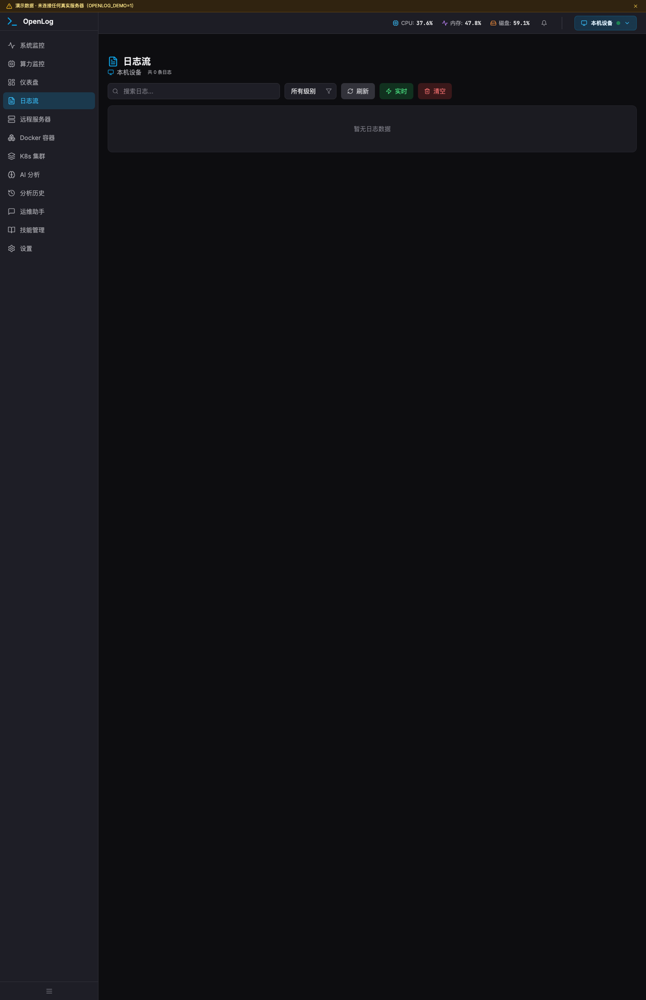

WebSocket 实时流、级别过滤（INFO/WARN/ERROR）、关键字搜索、来源筛选、
单条日志的 AI 归因入口。

## 远程服务器 · `/remote`

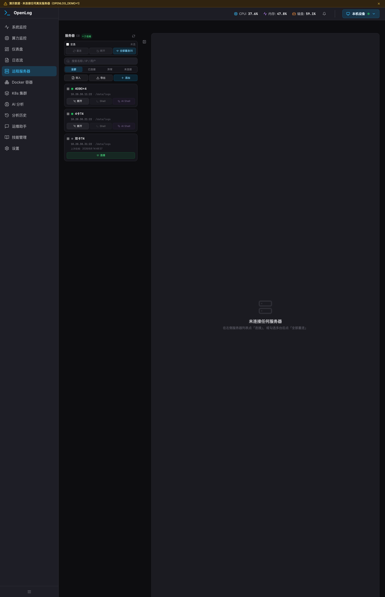

SSH 连接池管理：新增/编辑/删除、连接状态与重试原因、一键连上后的文件浏览与终端。

## Docker 容器 · `/docker`

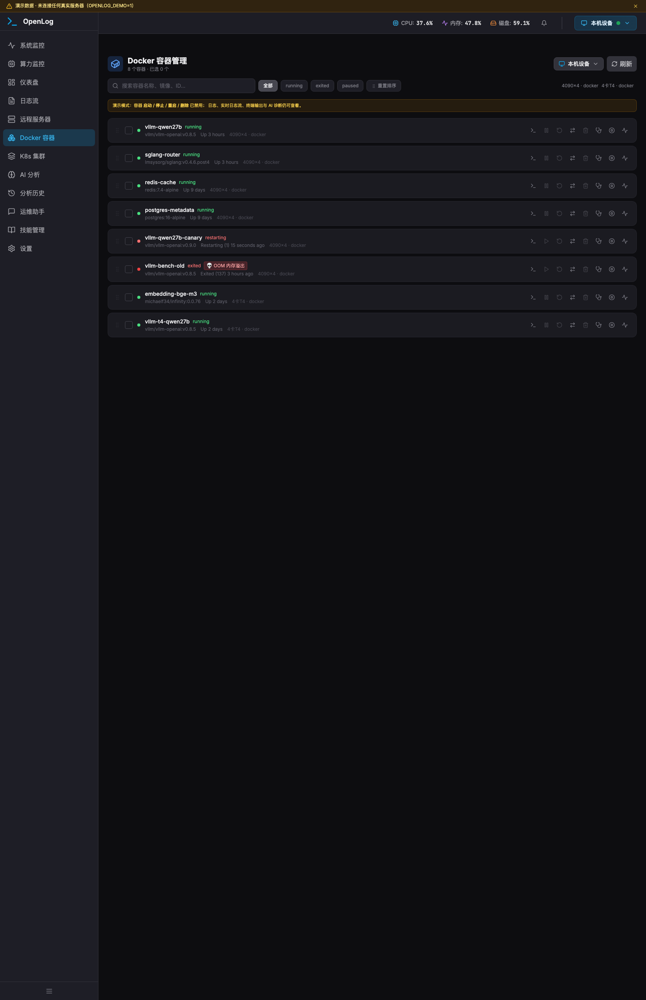

按来源（本机 / 远程主机）分组的容器列表、实时日志、内嵌终端、健康检查
（OOM 137、CrashLoopBackOff、未采集容器单独归类）。

## K8s 集群 · `/k8s`

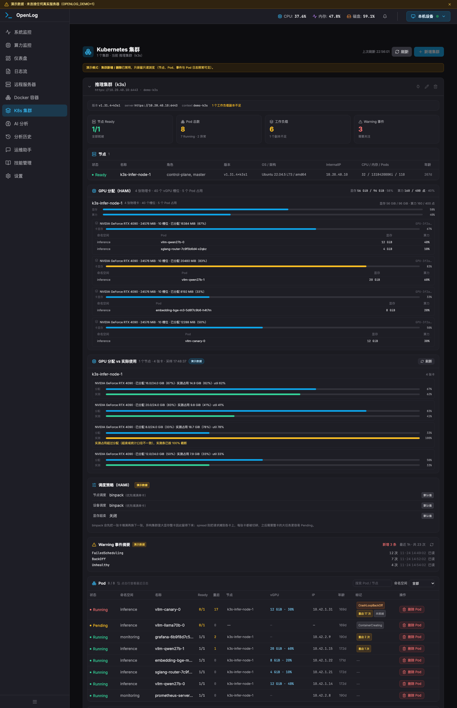

集群列表是**手风琴**：每行一个集群（名称 / apiserver 地址 / 连接状态），右侧三个操作
（测试连接 / 编辑 / 删除），点击行展开该集群的全部信息。

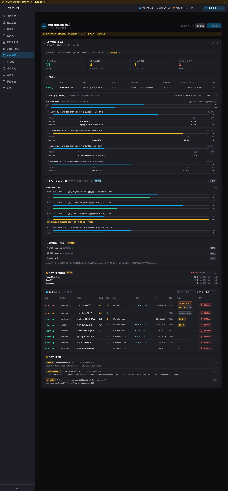

展开后自上而下：版本信息 → 统计卡 → 节点表 → **GPU 分配（HAMi）** → **GPU 使用率** →
**调度策略** → **Warning 摘要** → Pod 表（带操作列）→ 事件列表。

- **GPU 分配**：按物理卡展示型号、容量、vGPU 槽位、被哪些 Pod 占用多少显存/算力
- **GPU 使用率**：HAMi 的「分配」与 nvidia-smi 的「实测」并排（双进度条）
- **调度策略**：binpack / spread、显存超卖、来源标注（启动参数 / ConfigMap / 默认值）
- **Warning 摘要**：按 reason 聚合、次数、最后发生时间、标记已读

> 深链：`/k8s?cluster=<集群 id>` 直接展开指定集群。

## AI 分析 · `/analytics`

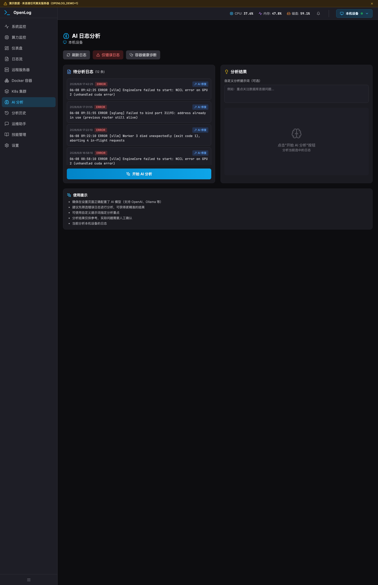

对日志或巡检结果做 AI 归因：输入来源、模型、结论、置信度与「立即修复」入口。

## 分析历史 · `/analysis-history`

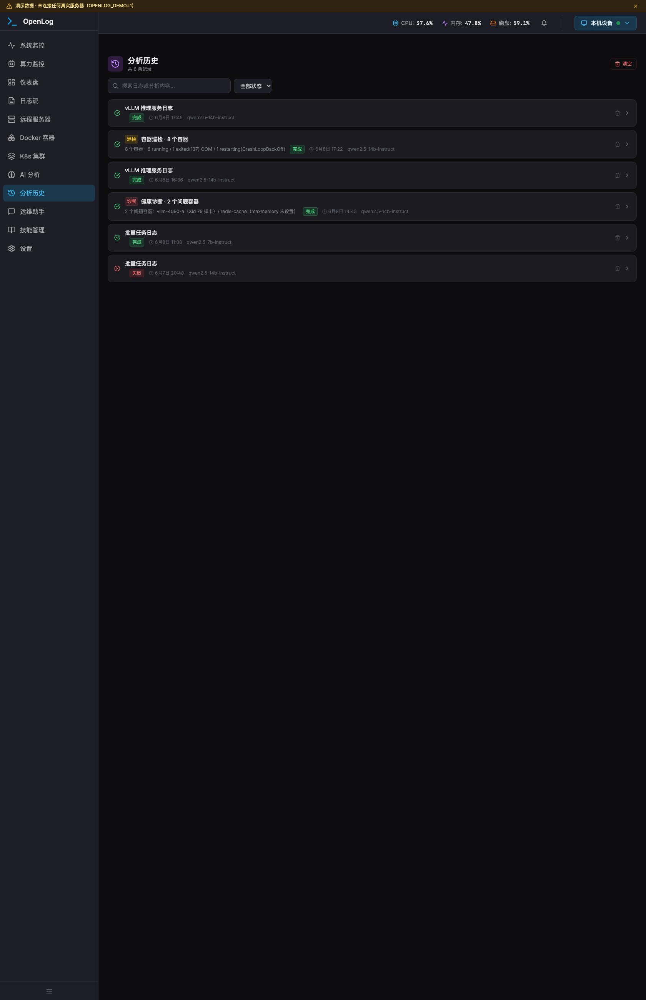

历史结论回溯：按来源/状态筛选、查看完整分析文本、删除记录。

## 运维助手 · `/assistant`

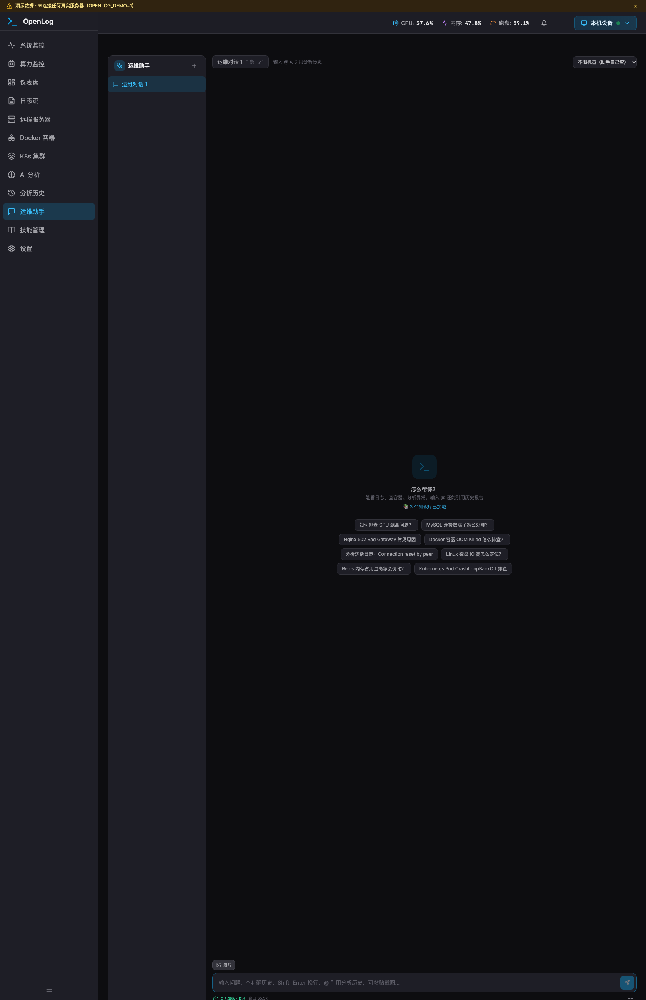

Agent 式排障：多轮工具调用（读日志、查容器、执行只读命令）、危险操作二次确认、
上下文用量条、工具调用链可视化。

## 技能管理 · `/skills`

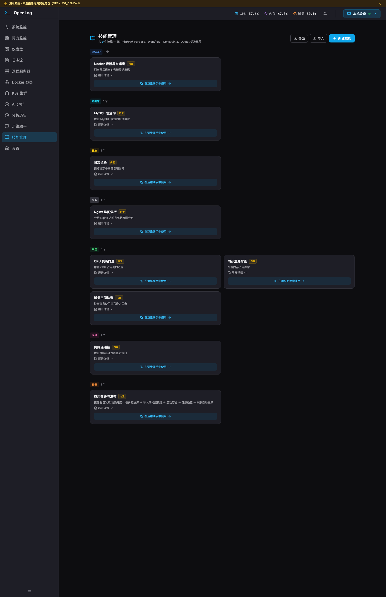

把排障流程沉淀成可复用技能（内置 9 个），支持自定义技能的提示词与工具白名单。

## 设置 · `/settings`

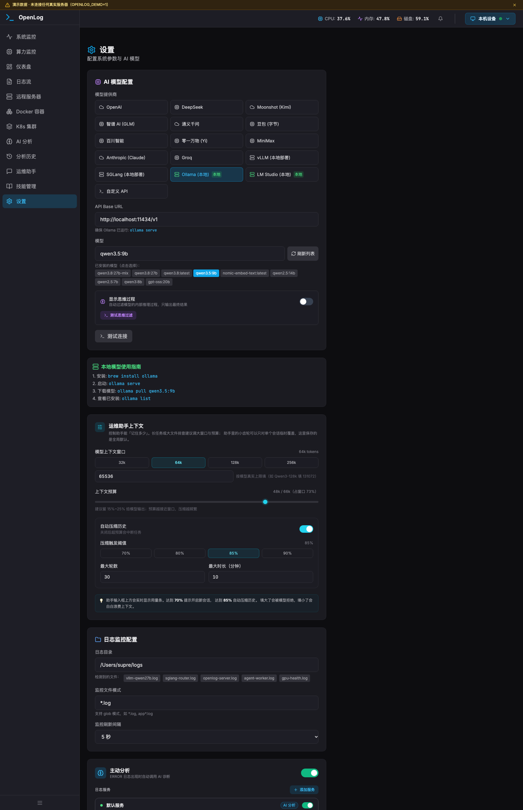

模型接入（OpenAI 兼容 / Ollama / 本地）、告警规则与 Webhook、容器监控阈值、
日志采集、数据库与 SSH 凭据等全部配置项。

---

## 截图是怎么生成的

```bash
# 1) 起演示实例（隔离数据目录，不碰真实数据）
OPENLOG_DEMO=1 OPENLOG_DATA_DIR=/tmp/openlog-demo/data npm run dev

# 2) 用无头 Chrome 逐页抓整页截图
for p in dashboard monitor gpu logs remote docker k8s analytics analysis-history assistant skills settings; do
  "/Applications/Google Chrome.app/Contents/MacOS/Google Chrome" \
    --headless=new --disable-gpu --hide-scrollbars \
    --window-size=1680,2600 --virtual-time-budget=12000 \
    --screenshot="docs/screenshots/$p.png" "http://127.0.0.1:5173/$p"
done
```

改版后重跑这段即可刷新图集。
